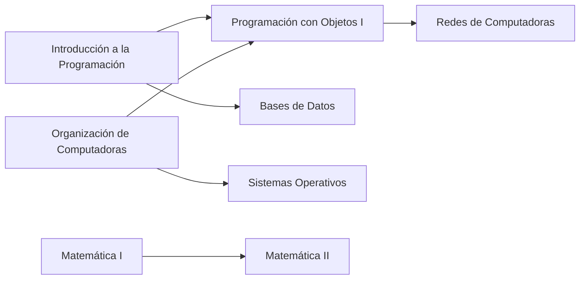

# Documentación de Requerimientos de Negocio (BRD)

**Proyecto:** Grafo Interactivo de Correlatividades y Seguimiento de Progreso Académico

---

## Ficha técnica del documento

| Campo                 | Detalle                                                              |
| --------------------- | -------------------------------------------------------------------- |
| Institución           | Universidad Nacional de Hurlingham (UNAHUR)                          |
| Unidad Académica      | Facultad de Informática — Proyecto Integrador Programación           |
| Tipo de documento     | BRD — Documentación de Requerimientos de Negocio                     |
| Versión               | 2.5                                                                   |
| Fecha                 | 20 de octubre de 2026                                              |
| Sponsor Operación     | Secretaría Académica / Dirección de Carrera                          |
| Sponsor Organización  | UNAHUR                                                               |
| Integrantes           | Perugini, Pablo; Acuña, Marcos; Masgo Sandoval, Joaquín; Renaud, Román; Remonda, Eliel; Cotera, Dylan |
| Release               | Diciembre 2026                                                       |

---

## Tabla de contenidos

1. [Historial de Cambios](#1-historial-de-cambios)
2. [Alcance](#2-alcance)
3. [Requerimientos de Negocio](#3-requerimientos-de-negocio)
4. [Requerimientos Funcionales](#4-requerimientos-funcionales)
5. [Pantallas de Usuario](#5-pantallas-de-usuario)
6. [Glosario](#6-glosario)
7. [Minutas de Reunión](#7-minutas-de-reunión)

---

## 1. Historial de Cambios

| Versión | Fecha        | Autor | Descripción      |
| ------- | ------------ | ----- | ---------------- |
| 1.0     | 10/09/2026   | Equipo | Versión inicial. |
| 2.0     | 24/09/2026   | Equipo | Revisión mayor alineada con la implementación actual. Se retiran los requerimientos que **no corresponden** a la aplicación: módulo de autenticación (registro/login/cookie), usuarios y roles, recuperación de contraseña, IA (matching semántico por embeddings, chat orientador y su orquestador multiproveedor) y pruebas automatizadas/CI. Se documenta el acceso sin cuenta (progreso por identificador local `x-user-id`), el título intermedio y las pantallas reales de la app. |
| 2.1     | 30/09/2026   | Equipo | Sugerencias de inscripción implementadas (R0–R6/C1–C6) + RN04 con sustento transitivo; FRD/BRD alineados. |
| 2.2     | 09/10/2026   | Equipo | Nueva arquitectura: cuentas JWT con roles USUARIO/ADMIN; universidades, carreras, planes de estudio y progreso por usuario; correlativas resueltas en el confirm (`prerequisites`); grafo y sugerencias por plan (`/study-plans/:id/graph`, `/study-plans/:id/sugerencias`); borrado en cascada; compose único de 4 servicios. |
| 2.3     | 14/10/2026   | Equipo | Catálogo curado por instituto (19 carreras canónicas, `isArchived`, filtros `?unit`/`includeArchived`, `withCounts`); Home Institutos→Carreras→Planes con "qué puedo cursar" y avance perezosos; **tecnicatura intermedia** (flag `intermediate`, sub-plan virtual `/study-plans/:id/intermediate`, pestañas Lic/Tec); **articulación** entre carreras (`continuesIn` + UI admin); **correlativas que bloquean el avance** (validación en backend + pre-chequeo en Mi progreso); promedio con notas y exportar CSV; seguridad (ADMIN en import/creación, `checkOrigin` CSRF, logout invalida JWT) y versionado liviano de planes; AppShell único por rol, Mi cuenta, Admin Usuarios y Archivadas; 26 unitarios. |
| 2.4     | 16/10/2026   | Equipo | **Tipo de carrera** (`careerType`: Licenciatura/Tecnicatura/Profesorado/Ingenieria/Otro) para distinguir el pregrado del grado en el catálogo; **título intermedio honesto**: aviso cuando el plan lo declara sin materias marcadas, **marcado en lote** (todo el plan / un año / un período) y **propuesta de IA revisable** validada contra las materias reales; chip 🎓 Tecnicatura en el catálogo; 32 unitarios. |
| 2.5     | 20/10/2026   | Equipo | **Inicio limpio**: la portada muestra solo inscripciones y accesos (*Ver materias*, *Qué puedo cursar* y *Mi avance* pasan a Mi progreso/grafo). **Baja reversible de planes**: quitar el plan conserva el progreso (inscripción archivada) y la reinscripción lo reactiva. Archivadas integradas a **Catálogo → Carreras**. **Edición de materias** en el plan con nombre visible editable y guardado en lote. **Validaciones reutilizables** de cuenta/registro (nombre, email, contraseña y confirmación) compartidas entre Registro y Mi cuenta. |

---

## 2. Alcance

### 2.1 Descripción del Proyecto / Objetivos

Desarrollar una aplicación web interactiva que represente el plan de estudios de una carrera universitaria como un **grafo dirigido**. La plataforma permitirá que:

- Los **estudiantes** visualicen el estado de sus materias (*Aprobada, Regular, Cursando, Pendiente*) y actualicen su progreso de manera interactiva sobre los nodos. Cada usuario tiene cuenta (registro/login con JWT): el progreso se asocia a su inscripción al plan.
- El **sistema** evalúe las correlatividades y desbloquee/bloquee automáticamente las materias sucesivas según el historial del alumno.
- El **administrador** (Dirección de Carrera) cargue una carrera, importe el plan oficial en PDF, edite correlatividades y publique el plan.

Ejemplo conceptual de las correlatividades que la aplicación debe representar:

### 2.2 Justificación

Los planes de estudio universitarios suelen ser complejos y estar llenos de dependencias cruzadas (correlativas para cursar o rendir). Los alumnos a menudo se confunden sobre qué materias pueden cursar según su historia académica. Una interfaz gráfica interactiva previene errores de inscripción y acelera la planificación de la carrera.

### 2.3 Hipótesis

- **H1:** Una visualización gráfica e intuitiva reduce la incertidumbre del estudiante al armar su cursada cuatrimestral.
- **H2:** El progreso asociado a la cuenta del usuario garantiza la persistencia de datos entre sesiones y dispositivos, sin depender de planillas manuales.

### 2.4 Restricciones

- La ingesta se basa en la estructura del PDF del plan de estudios exportado por **SIU-Guaraní** (tolera campos vacíos como créditos/puntaje).
- El lector de PDF lee las tablas de planes con columna de orden/código, horas y créditos, detecta la sección del **título intermedio** y descarta las filas de totales y los títulos de sección (no se importan como materias). Cuando el PDF **no tabula** las materias del título intermedio, el sistema no inventa: avisa al administrador y ofrece marcado en lote y una propuesta de IA revisable.
- La aplicación **NO reemplaza** la transacción de inscripción oficial (se efectúa en SIU-Guaraní); solo asiste la planificación.
- Compatibilidad garantizada con navegadores web modernos (Chrome, Edge, Firefox).
- Los planes soportados siguen el modelo año/cuatrimestre con créditos numéricos (entero o vacío).

> [!IMPORTANT]
> La aplicación es una herramienta de **planificación y asistencia**. La inscripción formal a materias siempre se realiza en **SIU-Guaraní**.

### 2.5 Supuestos

- El formato del PDF "Plan de Estudios" de SIU-Guaraní se mantiene estable durante el ciclo lectivo.
- El progreso se guarda asociado a la cuenta del usuario (registro/login con JWT, roles USUARIO/ADMIN).
- Los planes de las carreras soportadas siguen el modelo año/cuatrimestre con créditos numéricos (entero o vacío).

### 2.6 Dependencias

- Disponibilidad del reporte "Plan de Estudios" en PDF generado por el usuario.
- Servidor de base de datos (MongoDB) y caché (Redis) disponibles. Redis es **best-effort**: si no está disponible, la API funciona igual sin caché.
- Acceso al entorno de ejecución para deploy local.

### 2.7 Actores / Stakeholders

| Actor                        | Rol                                                                  |
| ---------------------------- | -------------------------------------------------------------------- |
| Estudiante                   | Consulta y actualiza su propio progreso sobre el grafo.              |
| Administrador / Dirección de Carrera | Carga y publica planes, edita correlatividades.              |
| Docentes                     | Consulta opcional (solo lectura), si lo requiere la secretaría.      |

> [!NOTE]
> **Decisión de diseño:** la implementación actual tiene cuentas con roles (`USUARIO`/`ADMIN`, JWT en cookie httpOnly `SameSite=Lax`, 7 días; Bearer admitido). Cargar y publicar planes y administrar el catálogo requiere `ADMIN`; cada usuario gestiona sus planes e inscripciones, su perfil y su progreso. Cerrar sesión invalida el token vigente. El progreso se asocia a la inscripción del usuario al plan.

### 2.8 Alcance del Proyecto

El alcance incluye:

- Visualizador gráfico del plan de estudios en forma de nodos interactivos (grafo) y en vista de tablero.
- Catálogo institucional **Instituto → Carrera → Plan** con colores oficiales, búsqueda de carreras y ocultamiento de carreras archivadas.
- Lógica backend de validación de correlatividades (matching clásico: exacto, compacto, difuso y por prefijo) junto con camino crítico, orden topológico y detección de ciclos.
- Seguimiento del progreso por materia y por plan, asociado a la cuenta del usuario, **con bloqueo del avance cuando falta una correlativa**.
- Carga de planes y de historiales académicos desde PDF, con edición de materias, correlatividades y publicación del plan (solo `ADMIN`).
- Soporte del **título intermedio / tecnicatura** (créditos, materias, sub-plan virtual y pestañas Licenciatura/Tecnicatura), con **marcado en lote** y **aviso** cuando queda sin materias marcadas.
- **Tipo de carrera** (`careerType`) para distinguir licenciaturas, tecnicaturas, profesorados e ingenierías en el catálogo (chip 🎓 Tecnicatura).
- **Articulación** entre carreras (`continuesIn`): el trayecto continúa en otra carrera (p. ej. tecnicatura → licenciatura).
- Motor de sugerencias de inscripción basado en reglas de negocio (C1–C6, R0–R6): `GET /study-plans/:id/sugerencias` + sección en Mi progreso (ver FRD §3.1.2).
- Panel de estadísticas del progreso del estudiante (porcentaje de avance, créditos, **promedio** y exportación a **CSV**).
- Administración de usuarios (roles USUARIO/ADMIN y baja) y restauración de carreras archivadas desde el catálogo, más **Mi cuenta** (perfil y contraseña).
- **Baja reversible** de la inscripción al plan: el estudiante puede quitar un plan sin perder su progreso y retomarlo más tarde con el avance intacto.

---

## 3. Requerimientos de Negocio

### 3.1 Reglas de Negocio

#### 3.1.1 Reglas del grafo y progreso académico

| ID   | Regla                    | Condición                                                                                 | Acción / Descripción                                                                                                       |
| ---- | ------------------------ | ----------------------------------------------------------------------------------------- | --------------------------------------------------------------------------------------------------------------------------- |
| RN01 | Estado inicial del nodo  | Los requisitos previos de la materia no están cumplidos en el historial del estudiante.    | La materia se muestra **bloqueada** (color gris, inhabilitada).                                                            |
| RN02 | Habilitación por correlativas | El estudiante marca una materia como *Aprobada* o *Regular* (según exija el plan).      | El sistema evalúa el grafo y habilita las materias sucesivas (disponibles, clickeables).                                   |
| RN03 | Persistencia de progreso | El usuario modifica el estado de un nodo.                                                 | El cambio se guarda asociado a su inscripción al plan en la base de datos (guardado explícito).                |
| RN04 | Restricción de desmarcado | El usuario desmarca una materia como aprobada.                                           | El sistema revierte el estado de las materias dependientes subsiguientes que quedaron sin sustento correlativo.            |
| RN05 | Bloqueo del avance por correlativas | El usuario intenta marcar una materia como *Cursando*, *Regularizada* o *Aprobada* sin tener cumplidas sus correlativas. | El backend rechaza el cambio (`400` con el detalle de la correlativa faltante) y la interfaz lo pre-chequea antes de guardar; volver a *Pendiente* siempre está permitido. |

#### 3.1.2 Reglas de sugerencia de inscripción

> [!NOTE]
> **Estado:** implementado el 30/09/2026 (`GET /study-plans/:id/sugerencias` + sección en Mi progreso, con las fusiones FRD y "últimos dos cuatrimestres" ≈ 12 meses por falta de término en el modelo).

| ID | Regla                 | Condición                                                                                                   | Acción                                                                       | Ref. |
| -- | --------------------- | ----------------------------------------------------------------------------------------------------------- | ---------------------------------------------------------------------------- | ---- |
| R0 | Encabezado            | Siempre.                                                                                                    | Enviar mensaje de encabezado al alumno.                                      | Msj0 |
| R1 | Correlativas          | El alumno regularizó ciertas materias.                                                                      | Sugerirle que curse las siguientes en orden de correlatividad.               | Msj1 |
| R2 | Regularizadas         | Se anotó en los últimos dos cuatrimestres en (y) materias y regularizó (x) materias.                        | Sugerirle que curse solo **(x + 1)** materias.                               | Msj2 |
| R3 | Materias comunes      | El alumno no cursó *Nuevos Entornos*, *Niveles de Inglés* o *Materias UNAHUR*.                              | Sugerirle que curse las materias comunes que no cursó.                       | Msj3 |
| R4 | Finales               | El alumno adeuda finales.                                                                                   | Sugerirle que rinda los finales pendientes.                                  | Msj4 |
| R5 | Orientación           | Inscripto hace más de 2 años y (< 3 materias regularizadas, no aprobó el 1er año o adeuda más de 4 finales). | Sugerirle que se dirija a la Dirección de Orientación y Acompañamiento.      | Msj5 |
| R6 | Cierre                | Siempre.                                                                                                    | Enviar mensaje de cierre al alumno.                                          | Msj6 |

> La implementación funcional de estas reglas (tabla de decisión completa y textos de los mensajes) se documenta en el **FRD, Sección 3** e implementada en `GET /study-plans/:id/sugerencias`.

### 3.2 Casos de Estudio

#### CS-01 · Estudiante de ingreso reciente

- **Condiciones:** Solo tiene disponibles las materias de primer año sin correlativas previas. El resto del grafo permanece bloqueado.
- **Acciones esperadas:** Al aprobar *Introducción a la Programación*, se habilitan automáticamente *Programación con Objetos I* y *Organización de Computadoras*.

#### CS-02 · Estudiante con recorrido avanzado

- **Condiciones:** Carga un historial con varias materias aprobadas.
- **Acciones esperadas:** El grafo refleja de inmediato un camino crítico abierto hacia materias de años superiores (ej. 3er año), permitiéndole visualizar qué le falta cursar para recibirse.

#### CS-03 · Alumno 1 (sugerencias)

- **Condiciones:** Regularizó ciertas materias, se inscribe en pocas, no cursó materias comunes, está inscripto hace más de 2 años sin aprobar todo el primer año.
- **Acciones:** sugerir correlativas, limitar la inscripción, recomendar materias comunes y derivar a orientación.

#### CS-04 · Alumno 2 (sugerencias)

- **Condiciones:** Regularizó algunas materias, adeuda finales y no cursó materias comunes.
- **Acciones:** sugerir correlativas, recomendar materias comunes y recomendar rendir finales.

#### CS-05 · Alumno 3 (sugerencias)

- **Condiciones:** Regularizó algunas materias y está inscripto hace más de 2 años con pocas regularizadas.
- **Acciones:** sugerir correlativas, limitar la inscripción y derivar a orientación.

---

## 4. Requerimientos Funcionales

El detalle funcional completo (User Stories, criterios de bondad, reglas de negocio implementadas) se encuentra en el documento complementario **FRD — Documentación de Requerimientos Funcionales**.

Resumen de la épica principal:

| Épica | Descripción                                                                                       | Estimación |
| ----- | ------------------------------------------------------------------------------------------------- | ---------- |
| EP-1  | Aplicación de correlatividades y progreso académico: grafo dirigido, actualización de progreso y gestión de planes. | 4 meses    |

---

## 5. Pantallas de Usuario

Vista de alto nivel. El detalle por pantalla se encuentra en el **FRD, Sección 5**.

| Pantalla   | Descripción                                                                     |
| ---------- | ------------------------------------------------------------------------------- |
| SC001      | Inicio: "Mis inscripciones" (filas con acciones Grafo/Tablero/Mi progreso/Quitar plan y "Sumar otra carrera") o Institutos → Carreras → Planes, con color por instituto, búsqueda y accesos de administración. |
| SC002      | Grafo del plan: nodos por estado, camino crítico, barra de progreso, banner de título intermedio y pestañas Licenciatura/Tecnicatura. |
| SC003      | Tablero del plan: el mismo contenido en columnas por año/cuatrimestre, con pestañas Licenciatura/Tecnicatura.          |
| SC004      | Mi progreso: estadísticas (aprobadas, créditos, avance, promedio), avance por año, edición por materia y exportación a CSV. |
| SC005      | Cargar plan: subida del PDF oficial, que crea la carrera y sus materias (solo ADMIN). |
| SC006      | Admin del plan: edición de materias (nombre por plan y guardado en lote) y correlatividades, **marcado en lote de tecnicatura**, tipo de carrera y publicación.           |
| SC007      | Mi cuenta: perfil (nombre, apellido, email) y cambio de contraseña.              |
| SC008      | Usuarios (ADMIN): listado, cambio de rol USUARIO/ADMIN y baja.                   |
| SC009      | Carreras archivadas (ADMIN, dentro de Catálogo → Carreras): listado con “Ver archivadas” y restauración. |
| SC010      | Acceso denegado (403) y página 404 para rutas inexistentes.                      |

---

## 6. Glosario

| Término                 | Descripción                                                                                          |
| ----------------------- | ---------------------------------------------------------------------------------------------------- |
| Grafo                   | Estructura de datos compuesta por vértices (nodos/materias) y aristas dirigidas que representan relaciones de correlatividad. |
| Correlativa             | Materia previa requerida obligatoriamente para poder cursar o rendir otra posterior.                   |
| Nodo bloqueado          | Materia que aún no puede cursarse por falta de requisitos previos en el historial académico.           |
| Materia disponible      | Materia que cumple todas las condiciones correlativas necesarias en el estado actual del alumno.       |
| Camino crítico          | Secuencia de materias cuya aprobación destraba la mayor cantidad de correlativas sucesivas hacia la titulación. |
| Historia de usuario     | Descripción corta y concisa desde el punto de vista del usuario final para definir una funcionalidad.  |
| Criterio de aceptación  | Condiciones que la funcionalidad debe cumplir para darse por completada y aprobada.                    |
| SIU-Guaraní             | Sistema informático utilizado por la universidad para la gestión de expedientes académicos y actas. La app importa su reporte "Plan de Estudios". |
| Instituto               | Unidad académica de la UNAHUR (Biotecnología, Tecnología e Ingeniería, Salud Comunitaria, Educación), con color oficial propio. |
| Tecnicatura intermedia  | Título intermedio del plan, modelado como sub-plan virtual (materias `intermediate` + `intermediateTitle`/`creditsIntermediate`). |
| Tipo de carrera         | `Career.careerType` (Licenciatura/Tecnicatura/Profesorado/Ingenieria/Otro) para distinguir el pregrado del grado en el catálogo. |
| Marcado en lote         | Marcar/desmarcar el flag de tecnicatura de muchas materias a la vez (todo el plan, un año o un período). |
| Articulación            | `Career.continuesIn`: carrera en la que un trayecto puede continuar (p. ej. tecnicatura → licenciatura). |
| Baja reversible         | Al quitar un plan con progreso, la inscripción se archiva (`archivedAt`) y conserva el avance; reinscribirse al mismo plan la reactiva sin perder nada. |
| Carrera archivada       | Carrera con `isArchived` que no se muestra en el catálogo salvo opt-in de `ADMIN`; se puede restaurar. |

---

## 7. Minutas de Reunión

| Fecha            | Tema                                             | Acuerdos / Pendientes                                      |
| ---------------- | ------------------------------------------------ | ---------------------------------------------------------- |
| 10/09/2026       | Reunión inicial del equipo: definición del alcance de la app. | Se definió el alcance del proyecto y los requerimientos iniciales. |