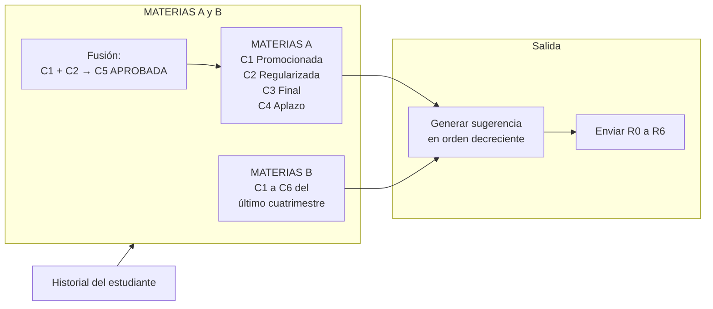

# Documentación de Requerimientos Funcionales (FRD)

**Proyecto:** Grafo Interactivo de Correlatividades y Seguimiento de Progreso Académico

---

## Ficha técnica del documento

| Campo                 | Detalle                                                              |
| --------------------- | -------------------------------------------------------------------- |
| Institución           | Universidad Nacional de Hurlingham (UNAHUR)                          |
| Unidad Académica      | Facultad de Informática — Proyecto Integrador Programación           |
| Tipo de documento     | FRD — Documentación de Requerimientos Funcionales                    |
| Versión               | 2.5                                                                  |
| Fecha                 | 16 de octubre de 2026                                              |
| Sponsor Operación     | Secretaría Académica / Dirección de Carrera                          |
| Sponsor Organización  | UNAHUR                                                               |
| Integrantes           | Perugini, Pablo; Acuña, Marcos; Masgo Sandoval, Joaquín; Renaud, Román; Remonda, Eliel; Cotera, Dylan |
| Release               | Diciembre 2026                                                       |

---

## Tabla de contenidos

1. [Historial de Cambios](#1-historial-de-cambios)
2. [Alcance](#2-alcance)
3. [Información de Requerimientos de Negocio](#3-información-de-requerimientos-de-negocio)
4. [Requerimientos Funcionales](#4-requerimientos-funcionales)
5. [Pantallas de Usuario](#5-pantallas-de-usuario)
6. [Glosario](#6-glosario)
7. [Minutas de Reunión](#7-minutas-de-reunión)

---

## 1. Historial de Cambios

| Versión | Fecha        | Autor | Descripción      |
| ------- | ------------ | ----- | ---------------- |
| 1.0     | 10/09/2026   | Equipo | Versión inicial. |
| 2.0     | 24/09/2026   | Equipo | Revisión mayor alineada con la implementación actual. Se retiran los requerimientos que **no corresponden** a la aplicación (historial 1.1–1.9): autenticación por cookie y usuarios, roles, recuperación de contraseña, chat del orientador con IA, matching semántico por embeddings, selector de carrera `?degree=`, compartir/exportar imagen y suites de tests con CI. Se documentan las pantallas reales, la identificación anónima por `x-user-id`, el título intermedio y el manejo centralizado de errores. |
| 2.1     | 30/09/2026   | Equipo | Sugerencias AR-3, RN03/`x-user-id`, SEG-1/5 (módulo `/users` sin UI), envelope de errores, Swagger 16 paths, suite `npm test` (14 tests). |
| 2.2     | 09/10/2026   | Equipo | Nueva arquitectura: cuentas JWT (USUARIO/ADMIN); universidades, carreras, planes e inscripciones; correlativas resueltas en el confirm; `GET /study-plans/:id/graph` y `/study-plans/:id/sugerencias`; borrado en cascada; scripts E2E con auth; compose único de 4 servicios; Swagger v2.0. |
| 2.3     | 14/10/2026   | Equipo | Catálogo por instituto (colores oficiales, `isArchived`, filtros `?unit`/`includeArchived`, `withCounts`); Home Institutos→Carreras→Planes; **tecnicatura intermedia** (`subject.intermediate`, `/study-plans/:id/intermediate`, pestañas Lic/Tec y avisos); **articulación** `continuesIn`; **RN05** correlativas que bloquean el avance (backend + pre-chequeo); promedio/CSV en Mi progreso; seguridad (ADMIN en import, `checkOrigin`, logout invalida JWT) + versionado liviano de planes; pantallas Mi cuenta/Usuarios/Archivadas/403; 26 unitarios. |
| 2.4     | 16/10/2026   | Equipo | **Tipo de carrera** (`Career.careerType` + chip 🎓 Tecnicatura en el catálogo); **marcado en lote** del título intermedio (`PATCH /study-plans/:id/subjects/intermediate` con alcance todo/año/período) y **avisos** de tecnicatura incompleta en Cargar plan y Editar plan; **clasificación IA revisable** del subconjunto del intermedio (columna *Tec* en el preview, validación dura con regresión unitaria); caché de extractos v3 (reintenta la clasificación al reutilizar un extracto pendiente por cuota — BUG-019); 32 unitarios (6 archivos). |
| 2.5     | 16/10/2026   | Equipo | **Panel ADMIN completo:** edición/borrado de institutos con **color persistido** y guardas `409` (carreras/subunidades), corrección de los typos históricos de `PATCH`/`GET` de institutos (BUG-020); edición, **archivado** y borrado de carreras (`409` con planes); articulación con selectores **buscables**, búsqueda y marcado múltiple; pestañas *Administrar entidades* en Cargar plan (flujo del PDF limpio); **default `REGULARIZADA`** para correlativas importadas + control masivo por plan; dropzone con estado de arrastre y vista previa (nombre + MB); notificaciones flotantes. Verificado: E2E v2.5 14/14 + correlativas 5/5 (scratch) + `npm test` 32/32. |

---

## 2. Alcance

### 2.1 Descripción del Proyecto / Objetivos

Desarrollar una aplicación web interactiva que represente el plan de estudios de una carrera universitaria como un **grafo dirigido**. La plataforma permitirá que:

- Los **estudiantes** visualicen el estado de sus materias (*Aprobada, Regular, Cursando, Pendiente*) y actualicen su progreso de manera interactiva sobre los nodos, con cuenta propia (registro/login con JWT).
- El **sistema** evalúe las correlatividades y desbloquee/bloquee automáticamente las materias sucesivas según el historial del alumno.
- El **administrador** (Dirección de Carrera) cargue una carrera, importe el plan oficial en PDF, edite correlatividades y publique el plan.

### 2.2 Justificación

Los planes de estudio universitarios suelen ser complejos y estar llenos de dependencias cruzadas (correlativas para cursar o rendir). Los alumnos a menudo se confunden sobre qué materias pueden cursar según su historia académica. Una interfaz gráfica interactiva previene errores de inscripción y acelera la planificación de la carrera.

### 2.3 Hipótesis

- **H1:** Una visualización gráfica e intuitiva reduce la incertidumbre del estudiante al armar su cursada cuatrimestral.
- **H2:** El progreso asociado a la cuenta del usuario garantiza la persistencia de datos entre sesiones y dispositivos, sin depender de planillas manuales.

### 2.4 Restricciones

- La ingesta se basa en la estructura del PDF exportado por **SIU-Guaraní** (tolera campos vacíos como créditos/puntaje).
- El lector de PDF descarta las filas de totales y los títulos de sección (no se importan como materias) y detecta la tabla del **título intermedio** cuando el plan la incluye.
- La aplicación **NO reemplaza** la transacción de inscripción oficial (se efectúa en SIU-Guaraní); solo asiste la planificación.
- Compatibilidad garantizada con navegadores web modernos (Chrome, Edge, Firefox).
- Los planes soportados siguen el modelo año/cuatrimestre con créditos numéricos (entero o vacío).

> [!IMPORTANT]
> La aplicación es una herramienta de **planificación y asistencia**. La inscripción formal a materias siempre se realiza en **SIU-Guaraní**.

### 2.5 Supuestos

- El formato del PDF "Plan de Estudios" de SIU-Guaraní se mantiene estable durante el ciclo lectivo.
- El progreso se guarda asociado a la cuenta del usuario (auth JWT), generado al registrarse en la app.
- Los planes de las carreras soportadas siguen el modelo año/cuatrimestre con créditos numéricos (entero o vacío).

### 2.6 Dependencias

- Disponibilidad del reporte "Plan de Estudios" en PDF generado por el usuario.
- Servidor de base de datos (MongoDB) y caché (Redis) disponibles; Redis es **best-effort** y la API funciona igual sin él.
- Acceso al entorno de ejecución para deploy local.

### 2.7 Actores / Stakeholders

| Actor                        | Rol                                                                  |
| ---------------------------- | -------------------------------------------------------------------- |
| Estudiante                   | Consulta y actualiza su propio progreso sobre el grafo.              |
| Administrador / Dirección de Carrera | Carga y publica planes, edita correlatividades.              |
| Docentes                     | Consulta opcional (solo lectura), si lo requiere la secretaría.      |

> [!NOTE]
> La implementación actual tiene cuentas con roles (`USUARIO`/`ADMIN`, JWT en cookie httpOnly `SameSite=Lax` 7 días, Bearer admitido): cargar y administrar el catálogo requiere `ADMIN`; cada usuario gestiona sus planes, inscripciones, perfil y progreso. Cerrar sesión invalida el token vigente (`tokenVersion`).

### 2.8 Alcance del Proyecto

El alcance incluye:

- Visualizador gráfico del plan de estudios en forma de nodos interactivos (grafo) y en vista de tablero.
- Catálogo institucional **Instituto → Carrera → Plan** con colores oficiales, búsqueda y ocultamiento de carreras archivadas.
- Lógica backend de validación de correlatividades (matching clásico: exacto, compacto, difuso y por prefijo), con camino crítico, orden topológico y detección de ciclos.
- Seguimiento del progreso por materia y por plan, asociado a la cuenta del usuario, **con bloqueo del avance cuando falta una correlativa** (RN05).
- Carga de planes y de historiales académicos desde PDF, con edición de materias, correlatividades y publicación del plan (solo `ADMIN`).
- Soporte del **título intermedio / tecnicatura**: detección en el PDF, flag `intermediate` por materia, sub-plan virtual y pestañas Licenciatura/Tecnicatura.
- **Articulación** entre carreras (`continuesIn`).
- Motor de sugerencias de inscripción basado en reglas de negocio (C1–C6, R0–R6): `GET /study-plans/:id/sugerencias` + sección en Mi progreso.
- Panel de estadísticas del progreso (avance, créditos, **promedio**, exportación a **CSV**).
- Administración de usuarios y de carreras archivadas, más **Mi cuenta** (perfil y contraseña).
- Manejo centralizado de errores en la API y en la interfaz.

---

## 3. Información de Requerimientos de Negocio

### 3.1 Reglas de Negocio

#### 3.1.1 Reglas del grafo y progreso académico

| ID   | Regla                    | Condición                                                                                 | Acción / Descripción                                                                                                       |
| ---- | ------------------------ | ----------------------------------------------------------------------------------------- | --------------------------------------------------------------------------------------------------------------------------- |
| RN01 | Estado inicial del nodo  | Los requisitos previos de la materia no están cumplidos en el historial del estudiante.    | La materia se muestra **bloqueada** (color gris, inhabilitada).                                                            |
| RN02 | Habilitación por correlativas | El estudiante marca una materia como *Aprobada* o *Regular* (según exija el plan).      | El sistema evalúa el grafo y habilita las materias sucesivas (disponibles, clickeables).                                   |
| RN03 | Persistencia de progreso | El usuario modifica el estado de un nodo.                                                 | El cambio se guarda asociado a su inscripción al plan en la base de datos (tiempo real o guardado explícito).                |
| RN04 | Restricción de desmarcado | El usuario desmarca una materia como aprobada.                                           | El sistema revierte el estado de las materias dependientes subsiguientes que quedaron sin sustento correlativo.            |
| RN05 | Bloqueo del avance por correlativas | El usuario intenta marcar una materia como *Cursando*, *Regularizada* o *Aprobada* sin tener cumplidas sus correlativas. | El backend rechaza el cambio (`400` con el detalle de la correlativa faltante) y el front lo pre-chequea antes de guardar; volver a *Pendiente* siempre está permitido. |

#### 3.1.2 Reglas de sugerencia de inscripción

> [!NOTE]
> **Estado:** implementado (Fase 6.1, 30/09/2026; migrado a planes el 09/10/2026) en `GET /study-plans/:id/sugerencias` + sección *Sugerencias de inscripción* en *Mi progreso*. Con la limitación honesta de que el modelo de progreso no registra abandono/ausencia (C4/C5/C6 no observables): rigen las fusiones (sin C4 → C1–C3; sin C1/C2 → C5) y "últimos dos cuatrimestres" ≈ actividad de 12 meses.

Para cada cuatrimestre se generan reglas de la forma **MATERIAS A ⇒ MATERIAS B**, calculadas sobre el historial del estudiante.

**MATERIAS A** — materias del historial de un estudiante que cumplen estas condiciones al **inicio de un cuatrimestre**:

| Regla     | Condición                                             | Acción                                    |
| --------- | ----------------------------------------------------- | ----------------------------------------- |
| C1        | Aprobada con nota mayor o igual a 7.                  | Incluir tupla (ID_MATERIA, C1) en A.      |
| C2        | Aprobada con nota mayor o igual a 4 y menor a 7.      | Incluir tupla (ID_MATERIA, C2) en A.      |
| C3        | Aprobada, pero adeuda final.                          | Incluir tupla (ID_MATERIA, C3) en A.      |
| C4        | La cursó, pero la abandonó o no la aprobó.            | Incluir tupla (ID_MATERIA, C4) en A.      |

**MATERIAS B** — materias del estudiante que cumplen estas condiciones en el **último cuatrimestre** (según cómo le fue):

| Regla     | Condición                                             | Acción                                    |
| --------- | ----------------------------------------------------- | ----------------------------------------- |
| C1        | Promocionada (nota mayor o igual a 7).                | Incluir tupla (ID_MATERIA, C1) en B.      |
| C2        | Regularizada (nota mayor o igual a 4 y menor a 7).    | Incluir tupla (ID_MATERIA, C2) en B.      |
| C3        | Aprobada, pero adeuda final.                          | Incluir tupla (ID_MATERIA, C3) en B.      |
| C4        | La cursó, pero no la aprobó.                          | Incluir tupla (ID_MATERIA, C4) en B.      |
| C5        | La cursó, pero la abandonó.                           | Incluir tupla (ID_MATERIA, C5) en B.      |
| C6        | Se inscribió, pero no asistió a clase (ausente).      | Incluir tupla (ID_MATERIA, C6) en B.      |

**Reglas de cómputo de la sugerencia:**

- Dado un estudiante y un inicio de cuatrimestre, calcular su respectivo conjunto **MATERIAS A** y armar la sugerencia.
- Calcular las estadísticas de las **MATERIAS B** y mostrarlas en orden **decreciente**.
- Si para un estudiante **no** hay materias que cumplan **C4** en MATERIAS A, considerar solamente las primeras tres condiciones **C1, C2, C3**.
- Si para un estudiante **no** hay materias que cumplan **C1 y C2** en MATERIAS A, fusionar las dos primeras condiciones en **C5 [APROBADA]**: *la cursó y aprobó con nota mayor o igual a 4* — incluir la tupla (ID_MATERIA, C5) en MATERIAS A.

#### 3.1.3 Reglas de comunicación (mensajes)

| Regla | Condición                                                                                                | Acción / Mensaje                                    |
| ----- | -------------------------------------------------------------------------------------------------------- | --------------------------------------------------- |
| R0    | Siempre.                                                                                                 | Msj0 — Encabezado estándar.                         |
| R1    | El alumno regularizó ciertas materias.                                                                   | Msj1 — Sugerir materias en orden de correlatividad. |
| R2    | Se anotó en los últimos dos cuatrimestres en (y) materias y regularizó (x) materias.                     | Msj2 — Sugerir inscribirse en (x + 1) materias.     |
| R3    | No cursó Nuevos Entornos, Niveles de Inglés o Materias UNAHUR.                                           | Msj3 — Sugerir materias comunes no cursadas.        |
| R4    | El alumno adeuda finales.                                                                                | Msj4 — Sugerir rendir finales pendientes.           |
| R5    | Está inscripto hace más de 2 años (4 cuatrimestres) y (tiene menos de 3 materias regularizadas, no aprobó todo el 1er año, o adeuda más de 4 finales). | Msj5 — Sugerir acudir a Orientación. |
| R6    | Siempre.                                                                                                 | Msj6 — Cierre estándar.                             |

**Textos de los mensajes:**

> [!TIP]
> Los mensajes se envían de forma encadenada en el orden R0 → R6 (encabezado → sugerencias → pie). El texto completo de cada uno está disponible en la sección plegable.

<b>Ver textos completos (Msj0 – Msj6)</b>

- **Msj0:** *Estimado/a estudiante, en función de tu recorrido académico, te enviamos las siguientes sugerencias de inscripción para el próximo período.*
- **Msj1:** *Por un lado, considerando las materias que regularizaste hasta ahora, te sugerimos que consideres para tu inscripción algunas de las siguientes materias, en función de las correlatividades de tu plan de estudios:* {Listar las materias correlativas a las regularizadas, indicando la carga horaria de cada una}
- **Msj2:** *Por otro lado, hemos notado que en tus últimos dos cuatrimestres te has inscripto a (y) materias y has regularizado (x) materia/s. Por lo tanto, para el próximo cuatrimestre te sugerimos que te inscribas en (x + 1) materias.*
- **Msj3:** *Recordá que también podés cursar las siguientes materias comunes en cualquier momento de la carrera y que, por su carga horaria semanal, pueden ser un buen complemento para materias con mayor carga teórica:* {Listar las materias comunes que no cursó}
- **Msj4:** *Asimismo, es importante que en la planificación de tu cursada consideres también la preparación de los exámenes finales de las siguientes materias:* {Listar las materias con final pendiente}
- **Msj5:** *Finalmente, nos parece fundamental sugerirte que te acerques a la Dirección de Orientación y Acompañamiento, donde podrán asesorarte y acompañarte en la planificación de tu trayectoria académica. Podés comunicarte con ellos en la siguiente dirección: orientacionestudiantil@unahur.edu.ar*
- **Msj6:** *La planificación del cuatrimestre es un acto fundamental para el sostenimiento de la cursada en la universidad. En la UNAHUR estamos para acompañarte.* (Cierre completo según plantilla institucional.)

### 3.2 Casos de Estudio

#### CS-01 · Estudiante de ingreso reciente

- **Condiciones:** Solo tiene disponibles las materias de primer año sin correlativas previas. El resto del grafo permanece bloqueado.
- **Acciones esperadas:** Al aprobar *Introducción a la Programación*, se habilitan automáticamente *Programación con Objetos I* y *Organización de Computadoras*.

#### CS-02 · Estudiante con recorrido avanzado

- **Condiciones:** Carga un historial con varias materias aprobadas.
- **Acciones esperadas:** El grafo refleja de inmediato un camino crítico abierto hacia materias de años superiores (ej. 3er año), permitiéndole visualizar qué le falta cursar para recibirse.

#### CS-03 · Alumno 1 — envío de sugerencias

| Regla                    | Condición                                           | Mensaje |
| ------------------------ | --------------------------------------------------- | ------- |
| R0 Encabezado            | Siempre.                                            | Msj0    |
| R1 Correlativas          | Regularizó Introducción a la Programación, Organización de Computadoras, Inglés I. | Msj1 |
| R2 Regularizadas         | Se anotó en 4 materias y regularizó 1.              | Msj2    |
| R3 Materias comunes      | No cursó Nuevos Entornos y Lenguajes ni Materias UNAHUR. | Msj3 |
| R5 Orientación           | Inscripto hace más de 4 cuatrimestres sin aprobar todo el 1er año. | Msj5 |
| R6 Cierre                | Siempre.                                            | Msj6    |

**Mensajes enviados:** Msj0, Msj1, Msj2, Msj3, Msj5, Msj6.

#### CS-04 · Alumno 2 — envío de sugerencias

| Regla                    | Condición                                           | Mensaje |
| ------------------------ | --------------------------------------------------- | ------- |
| R0 Encabezado            | Siempre.                                            | Msj0    |
| R1 Correlativas          | Regularizó Introducción a la Programación y Organización de Computadoras. | Msj1 |
| R3 Materias comunes      | No cursó Nuevos Entornos y Lenguajes, Materias UNAHUR, Inglés I. | Msj3 |
| R4 Finales               | Adeuda final de Matemática I.                       | Msj4    |
| R6 Cierre                | Siempre.                                            | Msj6    |

**Mensajes enviados:** Msj0, Msj1, Msj3, Msj4, Msj6.

#### CS-05 · Alumno 3 — envío de sugerencias

| Regla                    | Condición                                           | Mensaje |
| ------------------------ | --------------------------------------------------- | ------- |
| R0 Encabezado            | Siempre.                                            | Msj0    |
| R1 Correlativas          | Regularizó Organización de Computadoras y Matemática I. | Msj1 |
| R2 Regularizadas         | Se anotó en 4 materias y regularizó 2.              | Msj2    |
| R5 Orientación           | Inscripto hace más de 4 cuatrimestres con menos de 3 materias regularizadas por año. | Msj5 |
| R6 Cierre                | Siempre.                                            | Msj6    |

**Mensajes enviados:** Msj0, Msj1, Msj2, Msj5, Msj6.

---

## 4. Requerimientos Funcionales

### 4.1 User Stories

#### Épica EP-1 · Aplicación de correlatividades y progreso académico

| Campo          | Valor                                                            |
| -------------- | ---------------------------------------------------------------- |
| Proyecto       | Grafo Interactivo de Correlatividades                            |
| Status         | Draft                                                            |
| Responsable    | Dirección de Carrera UNAHUR                                      |
| Creado         | Septiembre 2026                                                  |
| Última actualización | Septiembre 2026                                            |
| Descripción    | Aplicación web que representa el plan de estudios como grafo dirigido, permitiendo a estudiantes visualizar y actualizar su progreso académico y a administradores cargar planes oficiales y editar correlatividades. |
| Estimación     | 4 meses                                                          |

#### Historias de usuario

| ID    | Como          | Quiero                                                                                                            | Para                                                                                    | Criterio de Aceptación                                                                                      | Dependencia |
| ----- | ------------- | ----------------------------------------------------------------------------------------------------------------- | --------------------------------------------------------------------------------------- | ----------------------------------------------------------------------------------------------------------- | ----------- |
| AR-1  | Estudiante    | Visualizar mi progreso académico en un grafo interactivo.                                                         | Planificar mi cursada.                                                                   | El sistema muestra materias aprobadas, regularizadas, cursando y pendientes con colores/nodos diferenciados. | —           |
| AR-2  | Administrador | Importar el plan de estudios en PDF y editar correlatividades.                                                    | Publicar la carrera.                                                                     | El sistema permite cargar PDF del plan y modificar relaciones entre materias.                               | —           |
| AR-3  | Estudiante    | Recibir sugerencias automáticas de inscripción dentro de la plataforma.                                           | Decidir mi inscripción según mi recorrido académico.                                    | **Implementado:** `GET /study-plans/:id/sugerencias` aplica las reglas R0–R6/C1–C6 (§3.1.2) y muestra las recomendaciones en *Mi progreso* y en "Qué puedo cursar" del Home. | —           |
| US-02 | Estudiante    | Visualizar el plan de estudios en forma de grafo interactivo.                                                     | Identificar rápidamente qué materias puedo cursar, cuáles tengo aprobadas y cuáles están bloqueadas. | Diferenciar claramente por colores según su estado (aprobada, disponible, bloqueada). **Título intermedio:** si la carrera lo otorga, un banner sobre el grafo muestra materias y créditos aprobados sobre el total del título intermedio. | —           |
| US-03 | Estudiante    | Hacer clic en una materia disponible para cambiar su estado.                                                       | Ver cómo se actualizan dinámicamente las materias subsiguientes en el grafo.             | Clickear en un nodo habilitado lo cambia de color e inmediatamente desbloquea los nodos hijos en pantalla.  | —           |
| US-04 | Estudiante    | Explorar el catálogo por instituto y carrera.                                                                     | Llegar rápido al plan que me interesa.                                                  | El Home muestra Institutos con su color oficial y `careerCount`; al elegir uno lista las carreras con planes publicados (ADMIN ve borradores) y permite buscar por nombre. | —           |
| US-05 | Estudiante    | Ver la **tecnicatura intermedia** de mi plan.                                                                     | Saber qué materias la componen y si sus correlativas cierran.                            | Pestañas Licenciatura/Tecnicatura en Grafo/Tablero/Progreso + detalle en Home (`/study-plans/:id/intermediate` con `closed`/`externalRequires`); aviso si no hay materias marcadas. | US-02       |
| US-06 | Administrador | Marcar la tecnicatura y la **articulación** entre carreras.                                                       | Publicar el trayecto completo.                                                           | Se marca `intermediate` por materia (una por una o **en lote**: todo el plan, un año o un período) y se editan `intermediateTitle`/`creditsIntermediate`; si el PDF declara el título sin tabular sus materias, la app **avisa** y la **IA puede proponer** el subconjunto (revisable en la columna *Tec* del preview); `continuesIn` se edita desde el catálogo (sin autorreferencia ni IDs inexistentes). | AR-2        |
| US-07 | Estudiante    | Ver mi **promedio** y **exportar** mi progreso.                                                                   | Compartir o respaldar mi avance.                                                         | Mi progreso calcula el promedio de las aprobadas con nota y ofrece "Exportar CSV" (código, materia, año, estado, nota, créditos). | AR-1        |
| US-08 | Administrador | Gestionar **usuarios** y **carreras archivadas**.                                                                 | Mantener el catálogo y los roles.                                                        | Admin Usuarios: cambiar rol USUARIO/ADMIN y eliminar; Admin Archivadas: restaurar carreras `isArchived`. | —           |
| US-09 | Usuario       | Editar **mi cuenta** y **cerrar sesión**.                                                                         | Mantener mis datos y mi seguridad.                                                       | Mi cuenta edita nombre/apellido/email y contraseña; cerrar sesión invalida el JWT vigente. | SC000       |
| US-10 | Administrador | Identificar el **tipo de carrera** (licenciatura, tecnicatura, profesorado, ingeniería).                          | Distinguir el pregrado del grado y ordenar el catálogo.                                  | `Career.careerType` (default `null`) se edita en el catálogo; las carreras `Tecnicatura` muestran el chip **🎓 Tecnicatura** en el Home. | US-06       |
| US-11 | Administrador | Administrar el **catálogo completo**: institutos (con color), carreras (editar/archivar/borrar) y articulación. | Mantener el catálogo al día sin romper dependencias ni planes. | Pestañas *Institutos · Universidades · Carreras · Articulación*: edición con whitelist, color con autoguardado, `409` con mensaje si hay carreras/planes/subunidades; carreras archivables (restaurables en *Carreras archivadas*) y borrables; articulación buscable. | SC005/SC006 |

### 4.2 Criterios de Bondad

- **MATERIAS BLOQUEADAS:** Materias del plan cuyos requisitos previos o correlatividades no están cumplidos en el historial del estudiante; permanecen inhabilitadas para cursar.
- **MATERIAS DISPONIBLES:** Materias que cumplen todas las condiciones correlativas necesarias en el estado actual del alumno; quedan habilitadas para su selección e inscripción en el grafo.
- **GESTIÓN DE ESTADOS Y DINÁMICA DEL GRAFO:** Calcular y actualizar en tiempo real el desbloqueo o bloqueo de materias sucesivas en función de los cambios de estado realizados por el usuario sobre los nodos.
- **MATERIAS A ⇒ MATERIAS B:** Para cada cuatrimestre, generar la sugerencia conforme las reglas C1–C6 (ver Sección 3.1.2) — implementado en `GET /study-plans/:id/sugerencias`.
- **ORDEN DE ESTADÍSTICAS:** Mostrar las estadísticas de MATERIAS B en orden **decreciente** — implementado (`materiasB` ordenado).
- **FUSIÓN DE CONDICIONES:** Si no hay materias C4 en MATERIAS A, usar solo C1, C2, C3. Si no hay materias C1/C2, fusionarlas en C5 [APROBADA] (nota ≥ 4) — implementado (las aprobadas sin nota van a C5 solo si no hay C1/C2, si no a C2).
- **CORRELATIVIDADES:** el matching entre el plan oficial y el PDF de correlativas es clásico (exacto, compacto, difuso/Levenshtein y por prefijo), con nivel de confianza devuelto en la respuesta (`exact` | `compact` | `fuzzy` | `null`).
- **TÍTULO INTERMEDIO:** si el PDF del plan declara un título intermedio, el backend expone sus créditos y materias (`creditsIntermediate`, `intermediateTitle`, `subject.intermediate`) y ofrece un **sub-plan virtual** (`GET /study-plans/:id/intermediate`, con `closed` y `externalRequires`); el grafo, el tablero y Mi progreso muestran **pestañas Licenciatura/Tecnicatura** y avisan cuando la tecnicatura no tiene materias marcadas. En carreras sin título intermedio no se muestran.
- **TÍTULO INTERMEDIO — HONESTIDAD DEL DATO:** el subconjunto solo se marca de forma determinística cuando el PDF trae la sección que lo tabula (Lic. en Informática); si no la trae, el sistema **no inventa**: avisa al ADMIN (preview y Editar plan), permite marcar **en lote** y, si la IA propone un subconjunto, la propuesta se **valida contra las materias reales** (sin filas ACA, mínimo 4 materias, tramo ≤ 3 años lectivos), se muestra en la columna *Tec* del preview y es descartable. La IA nunca persiste nada por su cuenta.
- **TIPO DE CARRERA:** `Career.careerType` ∈ {Licenciatura, Tecnicatura, Profesorado, Ingenieria, Otro} ∪ {null}; se edita en el catálogo (ADMIN) y las tecnicaturas se etiquetan en el Home con el chip 🎓. El tipo no altera permisos ni correlativas: es información de catálogo.
- **CATÁLOGO ADMINISTRABLE:** el panel *Administrar entidades* (pestañas *Institutos · Universidades · Carreras · Articulación*) permite **editar** institutos (con **color** persistido y autoguardado), **eliminarlos** (`409` con mensaje si tienen carreras o subunidades), **editar/archivar/borrar** carreras (`409` si tienen planes; el archivado es restaurable) y **guardar articulación** con selector buscable y marcado múltiple. Las guardas preservan la integridad: nunca se borra en cascada una carrera o un instituto con dependencias.
- **CORRELATIVAS BLOQUEANTES:** al guardar el progreso, el backend rechaza avanzar (CURSANDO/REGULARIZADA/APROBADA) si no se cumple cada `prerequisite` con su `requiredStatus`; el front avisa antes de guardar. Las correlativas **importadas** (confirm del plan y correlativas desde PDF) se guardan con `requiredStatus: REGULARIZADA` por defecto —regular habilita la correlativa, criterio UNAHUR—; exigir `APROBADA` es una decisión explícita del ADMIN, por materia o en bloque por plan. Volver a PENDIENTE siempre se permite.
- **ARTICULACIÓN:** una carrera puede declarar `continuesIn` con **una o más** carreras; el panel admin permite buscar la carrera y marcar sus continuaciones, y el catálogo del inicio las muestra como el mismo trayecto ("Continúa en …").
- **PROMEDIO Y EXPORTACIÓN:** Mi progreso calcula el promedio de las materias aprobadas con nota y permite exportar el estado por materia a **CSV**.
- **MANEJO DE ERRORES:** toda falla se responde en JSON con un mensaje en español (`400` validaciones y IDs inválidos, `404` recurso inexistente, `409` duplicados, `500` genérico); la interfaz no se rompe y muestra el mensaje (`ErrorBoundary` + `api/client.ts`).

### 4.3 Requisitos de Seguridad

- **Con autenticación:** la aplicación tiene cuentas con roles (`USUARIO`/`ADMIN`, JWT en cookie httpOnly `SameSite=Lax` de **7 días**; Bearer admitido). El catálogo es público; las mutaciones de catálogo y la importación de planes (`preview`/`confirm`) requieren `ADMIN`; planes, importaciones e inscripciones son por dueño. **Cerrar sesión invalida el token** (`tokenVersion`). Las mutaciones autenticadas por cookie pasan por `checkOrigin` (defensa CSRF).
- **Identificación del progreso:** el progreso se asocia a la inscripción del usuario al plan. Las rutas exigen JWT (`401` sin token, `403`/`404` sin permiso).
- **Subida de archivos:** solo se aceptan archivos PDF (firma `%PDF-` verificada en servidor, además del mimetype) de hasta **10 MB**, que se procesan en memoria y no se persisten en disco; el preview tiene cota de IA (`aiRateLimit`, redes privadas exentas).
- **Errores:** todas las respuestas de error vienen en JSON con un mensaje en español (`400` para IDs inválidos y validaciones, `401` sin auth, `404` para recursos inexistentes, `409` para duplicados y conflictos de borrado, `500` genérico sin detalle interno); la interfaz las muestra sin romperse.
- **Datos personales:** el modelo `User` guarda nick, nombre, apellido, email y hash `bcrypt`; el JSON nunca expone `password`.

---

## 5. Pantallas de Usuario

### SC001 · Inicio (`/`)

- **Acceso:** requiere login (`/login`); registro en `/register`.
- **Comportamiento:** si el usuario tiene inscripciones, aterriza en **Mis inscripciones** (tarjetas de esos planes); si no, en **Institutos**. Navega **Instituto → Carrera → Plan** (con color oficial por instituto y búsqueda de carreras). Cada tarjeta de plan ofrece detalles perezosos: **Tecnicatura** (materias y `closed`), **Qué puedo cursar** (sugerencias AR-3), **Mi avance** y **Ver materias**. Muestra la **articulación** ("Continúa en …"). El ADMIN ve además borradores y accesos de administración.

### SC000 · Acceso (`/login`, `/register`)

- **Campos login:** nickName + password → JWT en cookie httpOnly (7 días; Bearer admitido). Cerrar sesión invalida el token.
- **Campos registro:** nickName, firstName, lastName, email, password (mín. 6); el rol siempre es `USUARIO` (el `ADMIN` lo asigna otro admin o directo en DB).

### SC002 · Grafo del plan (`/grafo/:id`)

- **Lienzo interactivo** (React Flow) con las materias organizadas por años/cuatrimestres y las correlativas como aristas dirigidas.
- Estados de cada materia: *Aprobada, Regular, Cursando, Pendiente* (colores diferenciados) y badge **"crítico"** en las materias del camino crítico.
- **Barra superior** con el progreso porcentual de la carrera y la leyenda del camino crítico.
- **Panel de detalles** de la materia seleccionada al hacer clic, con sus correlatividades y la posibilidad de cambiar su estado.
- **Banner de título intermedio** (solo si la carrera lo otorga): materias y créditos aprobados sobre el total del título intermedio, con barra de progreso.
- **Pestañas Licenciatura/Tecnicatura:** acotan el subgrafo a la tecnicatura intermedia cuando el plan la declara; si la tecnicatura no tiene materias marcadas se muestra un aviso (no repite la Licenciatura).
- **Cambio de vista** a tablero desde la misma pantalla.

### SC003 · Tablero del plan (`/tablero/:id`)

- La misma información del grafo presentada en columnas por año/cuatrimestre, pensada para lectura lineal, con **pestañas Licenciatura/Tecnicatura** y aviso cuando la tecnicatura no tiene materias marcadas.

### SC004 · Mi progreso (`/progreso`)

- Resumen del avance: **materias aprobadas, créditos, avance (%), faltantes y promedio**, con **avance por año**.
- **Plan de trabajo:** selector de plan limitado a los planes en los que el usuario está **inscripto** ("Agregar a mi progreso" si no lo está).
- **Importación del historial en PDF:** sube el PDF de la historia académica, reconoce las materias aprobadas y las previsualiza antes de guardar.
- **Edición manual:** se cambia el estado (*Aprobada, Regularizada, Cursando, Pendiente*) y la nota de cada materia, con **pestañas Licenciatura/Tecnicatura**, guardado masivo y **pre-chequeo de correlativas** (no deja avanzar sin ellas).
- **Exportar CSV** del estado por materia.

### SC005 · Cargar plan (`/cargar`)

- **Zona de arrastre** (solo `ADMIN`) para subir el PDF del plan oficial: se previsualiza (`preview`, sin guardar), se revisa y se confirma (`confirm`); se guardan las materias con créditos y título intermedio cuando el plan los declara.
- **Tabla de revisión con columna *Tec* editable:** permite ver y corregir qué materias pertenecen al título intermedio (incluida la propuesta de la IA) antes de confirmar; si el plan declara título intermedio y ninguna materia quedó marcada, se muestra un **aviso** con la recomendación de marcarlas luego en *Editar plan*.
- **Lista de trabajos de importación** con su estado (*creando → parseando → guardando*) y mensaje de error si el PDF no tiene texto extraíble ("parece escaneado").
- **Panel *Administrar entidades*** en la misma pantalla, en **pestañas** (*Institutos · Universidades · Carreras · Articulación*) para no ensuciar el flujo del PDF: institutos con **color autoguardado**, edición y borrado con guardas (`409` con carreras/subunidades); universidades para altas (la recién creada queda pre-seleccionada); carreras con alta/edición, archivado y borrado (`409` con planes); articulación con selector buscable y marcado múltiple. Cada acción avisa con **notificaciones flotantes** (arriba a la derecha, autocierre a los 6 s).
- **Zona de arrastre** que resalta en verde punteado al arrastrar y muestra los archivos elegidos (nombre + tamaño en KB/MB) antes de procesarlos.
- Accesos directos a *ver grafo*, *ver tablero* y *editar* una vez terminada la importación, más la opción de publicar o eliminar el plan.

### SC006 · Admin del plan (`/admin/:id`)

- Tabla de carreras con su estado (**Publicada** / **Borrador**), selección de la carrera a editar y acceso al tablero.
- **Edición de materias:** tabla con datos, horas, créditos y la marca **"Título intermedio"** / tecnicatura (`intermediate`) cuando corresponde, más una **barra de marcado en lote** (alcance: todas las materias o un año) con contador de materias marcadas y **aviso** cuando hay título intermedio sin materias marcadas.
- **Editor de correlatividades:** se marcan los requisitos de cada materia y se muestran los cambios pendientes (contador de "cambios sin guardar") antes de guardar.
- **Catálogo (panel *Administrar entidades* de *Cargar plan*):** pestañas *Institutos · Universidades · Carreras · Articulación*; institutos con **color persistido**, edición y borrado con guardas (`409` con carreras/subunidades); carreras con edición (nombre/tipo/universidad/instituto), **tipo de carrera** (`careerType`), **articulación** (`continuesIn`, múltiple y buscable), archivado (`isArchived`, restaurable) y borrado (`409` con planes).
- **Publicación** del plan para que los estudiantes lo vean.

### SC007 · Mi cuenta (`/cuenta`)

- Muestra nickName y rol; permite editar nombre, apellido y email y cambiar la contraseña (mín. 6 caracteres).

### SC008 · Usuarios (`/admin/users`, solo ADMIN)

- Tabla de usuarios con nickName, email y rol; permite **hacer/quitar ADMIN** y **eliminar** usuarios.

### SC009 · Carreras archivadas (`/admin/archivadas`, solo ADMIN)

- Lista las carreras con `isArchived` y permite **restaurarlas**.

### SC010 · Acceso denegado y 404 (`/403`, `*`)

- `/403` se muestra cuando un `USUARIO` intenta acceder a rutas de administración; `*` renderiza la página 404 para rutas inexistentes.

---

## 6. Glosario

| Término                 | Descripción                                                                                          |
| ----------------------- | ---------------------------------------------------------------------------------------------------- |
| Grafo                   | Estructura de datos compuesta por vértices (nodos/materias) y aristas dirigidas que representan relaciones de correlatividad. |
| Correlativa             | Materia previa requerida obligatoriamente para poder cursar o rendir otra posterior.                   |
| Nodo bloqueado          | Materia que aún no puede cursarse por falta de requisitos previos en el historial académico.           |
| Materia disponible      | Materia que cumple todas las condiciones correlativas necesarias en el estado actual del alumno.       |
| Camino crítico          | Secuencia de materias cuya aprobación destraba la mayor cantidad de correlativas sucesivas hacia la titulación. |
| MATERIAS A              | Conjunto de materias del historial del estudiante que cumplen las reglas C1–C4 al inicio de un cuatrimestre. |
| MATERIAS B              | Conjunto de materias del último cuatrimestre del estudiante que cumplen las reglas C1–C6.             |
| User Story              | Descripción corta y concisa desde el punto de vista del usuario final para definir una funcionalidad.  |
| Criterio de aceptación  | Condiciones que la funcionalidad debe cumplir para darse por completada y aprobada.                    |
| SIU-Guaraní             | Sistema informático utilizado por la universidad para la gestión de expedientes académicos y actas. La app importa su reporte "Plan de Estudios". |
| Instituto               | Unidad académica UNAHUR (Biotecnología, Tecnología e Ingeniería, Salud Comunitaria, Educación) con color oficial propio. |
| Tecnicatura intermedia  | Título intermedio modelado como sub-plan virtual (`subject.intermediate` + `intermediateTitle`/`creditsIntermediate`, `GET /study-plans/:id/intermediate`). |
| Marcado en lote         | Marcar/desmarcar el flag `intermediate` de muchas materias a la vez (`PATCH /study-plans/:id/subjects/intermediate`): todo el plan o filtrado por año/período. |
| Tipo de carrera         | `Career.careerType` (Licenciatura/Tecnicatura/Profesorado/Ingenieria/Otro): etiqueta el catálogo; "Tecnicatura" muestra el chip 🎓 en el Home. |
| Articulación            | `Career.continuesIn`: carrera en la que un trayecto puede continuar. |
| Carrera archivada       | Carrera con `isArchived` oculta del catálogo salvo opt-in de `ADMIN`. |

---

## 7. Minutas de Reunión

| Fecha            | Tema                                             | Acuerdos / Pendientes                                      |
| ---------------- | ------------------------------------------------ | ---------------------------------------------------------- |
| 10/09/2026       | Reunión inicial del equipo: definición del alcance de la app. | Se definió el alcance del proyecto y los requerimientos iniciales. |